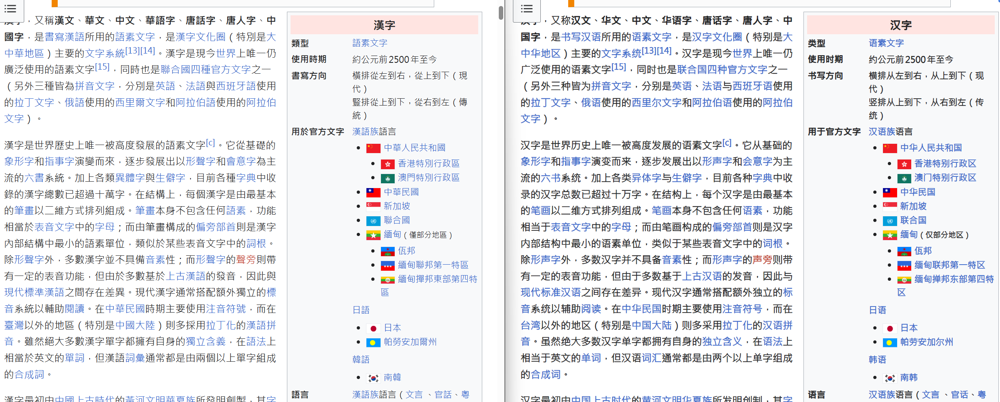

# zh-t2s

基于 [opencc-js](https://github.com/nk2028/opencc-js) 的 Tampermonkey 网页繁简转换脚本，默认繁→简，支持简→繁、动态内容和自定义词典。

[](https://greasyfork.org/zh-CN/scripts/585653-%E7%B9%81%E8%BD%AC%E7%AE%80-zh-t2s)
[](https://github.com/weiningwei/zh-t2s)
[](LICENSE)
[](CHANGELOG.md)



*左：原文；右：繁→简转换后。*

## 功能

- 双向转换，简→繁可选择台湾或香港字形。
- OpenCC 按上下文处理一对多字形，默认不改变地区用词。
- 自定义词典可修正少见词、保留人名，支持实时预览与 JSON 导入导出。
- 动态内容自动转换，在浏览器空闲时分批处理。
- 浮动面板、快捷键和域名白名单控制，关闭时还原原文。

## 安装

1. 安装 [Tampermonkey](https://www.tampermonkey.net/)。
2. 在 [Greasy Fork 脚本页](https://greasyfork.org/zh-CN/scripts/585653-%E7%B9%81%E8%BD%AC%E7%AE%80-zh-t2s) 点击“安装此脚本”。也可打开 [源码](zh-t2s.user.js)，点击 Raw 安装，或新建脚本粘贴内容。
3. 访问中文网页，默认开启繁→简。后续通过脚本管理器检查更新。

## 使用

### 开关、方向与面板

| 入口 | 操作 |
| --- | --- |
| 浮动按钮左键 | 展开／收起面板，查看当前状态与转换统计 |
| 浮动按钮右键 | 切换繁→简／简→繁方向 |
| 拖拽浮动按钮 | 移动位置，刷新后保留 |
| 面板方向分段 | 开启所选方向；面板开关用于关闭或按上次方向重新开启 |
| `F8` / `F9` | 分别切换繁→简／简→繁；按当前方向的快捷键会关闭转换 |
| 油猴菜单 | 繁→简、简→繁、重置所有设置、显示／隐藏浮动按钮，共 4 项 |

油猴菜单点击当前方向项会关闭转换，点击另一项会切换方向。关闭时还原原文；切换方向时先还原再重新转换。输入框、文本域、可编辑区域聚焦或词典编辑器打开时，转换快捷键不响应。当前没有快捷键配置入口，旧版本已保存的配置仍会读取。

方向和开关全局持久保存，已打开的同源标签页通过广播同步，其他站点刷新后读取。按钮会显示当前页的实际状态，包括已关闭、已忽略或引擎未加载。

繁体字形、白名单和自定义词典在面板内操作。隐藏按钮后，先用油猴菜单“👁 显示浮动按钮”恢复入口。

### 繁体字形

简→繁时，面板提供台湾／香港两档，默认台湾。例如 `里面` 分别转换为 `裡面`／`裏面`，`吃饭` 均为 `吃飯`。两档只切换字形，默认不改地区用词，例如 `软件` 仍为 `軟件`。自定义词典优先于默认结果。

字形选择会保存，切换后当前页立即重新转换，并同步同源标签页。

### 白名单

在浮动面板中加入／移出当前域名，立即生效；清空整个名单需要确认。按 `location.hostname` 精确匹配，不区分路径，`zh.wikipedia.org` 与 `en.wikipedia.org` 视为不同域名。

### 统计与重置

面板页眉统计的是发生变化的文本或属性的原文总长度，按整段累计，并非逐字差异；耗时包含自定义词典匹配与 OpenCC 转换。刷新页面、切换方向、字形或词典时重新计数。

“重置所有设置”会清空词典、方向、字形、快捷键、白名单和浮动按钮偏好，确认后刷新页面。词典建议先导出备份。

## 自定义词典

### 录入与预览

点击浮动面板 → **📖 自定义词典**，选择繁→简或简→繁，每行填写“网页原词 → 期望结果”。例如在繁→简页签中：

```text
滑鼠 => 鼠标
乾隆 => 乾隆
```

第一条将“滑鼠”显示为“鼠标”；左右相同表示保留原词。修改一行即可编辑，删除整行即可删除规则。

分隔符支持 `=>`、`->`、`→`、`＝＞`、`＝>`；从表格复制两列可直接粘贴，Tab 会被识别为分隔符（手动按 Tab 会切换焦点）。两侧首尾空格会去除，空行忽略。

在“试一下”中输入示例文字，可用当前页签的草稿规则预览结果。预览不保存、不改动页面；两个方向的草稿均须通过校验。停止输入约 300ms 后，状态栏会显示已识别的规则条数（分方向统计）或首条错误，不必等到保存；预览遇到规则错误时只提示查看状态栏。点击“保存并应用”才会生效，取消未保存的修改会提示确认。

### 匹配规则与限制

- 匹配网页原文，同一位置优先最长词。命中的词直接输出指定结果，其余部分交给 OpenCC；结果不再转换或触发其他规则。
- 繁→简、简→繁独立配置，不自动生成反向规则。台湾／香港字形共用简→繁词典。
- 按字面匹配、区分大小写，不支持正则；不跨 HTML 文本节点，例如 `<span>滑</span><span>鼠</span>` 无法命中“滑鼠”。
- 尽量使用整词。单字规则可能切断 OpenCC 的分词上下文：简→繁配置 `头 => 头`，可能使“头发”变成“头發”；应写成 `头发 => 头发`。
- 每方向最多 1000 条，原词最多 256、替换词最多 1024 个 UTF-16 代码单元。左右均不可为空，同方向原词不可重复。
- 词内不支持换行、制表符或 `=>`。解析时优先识别标准分隔符 `=>`；原词含 `->`、`→` 等其他分隔符字符时，请使用 `=>` 分隔，JSON 导入后也会按此格式显示。

### 生效与备份

词典全站持久保存。保存后当前页从原文重新转换，动态内容也适用；其他页面在切回前台或打开词典编辑器时读取更新，按需重扫。保存前若发现其他页面已修改词典，会确认是否覆盖。关闭转换、白名单和忽略区域仍然有效。

“导出 JSON”导出两个方向的当前草稿；“导入 JSON”将文件中的两个方向载入草稿，仍需保存后生效。文件最大 2 MB，格式如下：

```json
{
  "t2s": [["滑鼠", "鼠标"], ["乾隆", "乾隆"]],
  "s2t": [["头发", "頭髮"]]
}
```

清空某方向的全部文本并保存，即可清空该方向的词典。

## 转换范围与限制

处理正文、标题、按钮文字，以及 `title`、`alt`、`aria-label`、`placeholder`、`data-placeholder` 属性。输入框、文本域的内容和属性不处理；跳过代码、样式、模板及嵌入内容，不转换正在编辑的富文本。

默认通过 `@noframes` 禁止在 iframe 中运行。转换仍受浏览器及脚本管理器允许访问的页面范围限制。

网页作者可给元素添加 `class="ignore-opencc"`，使其内容与属性保持原样：

```html
<div class="ignore-opencc">這裡的繁體字保持不變</div>
```

## 依赖与反馈

唯一依赖为通过 jsDelivr `@require` 加载的 `opencc-js@1.4.2`，字典已打包，无需额外下载。引擎不可用时，转换与预览禁用；若脚本已运行，菜单和面板仍可管理设置。可检查控制台的 `[zh-t2s]` 警告及 CDN 连通性。

问题请提交到 [GitHub Issues](https://github.com/weiningwei/zh-t2s/issues)，历史变更见 [CHANGELOG](CHANGELOG.md)。修改源码、扫描与同步机制见 [维护说明](docs/DEVELOPMENT.md)，截图更新见 [截图说明](docs/README.md)。

许可证：[MIT](LICENSE)。
